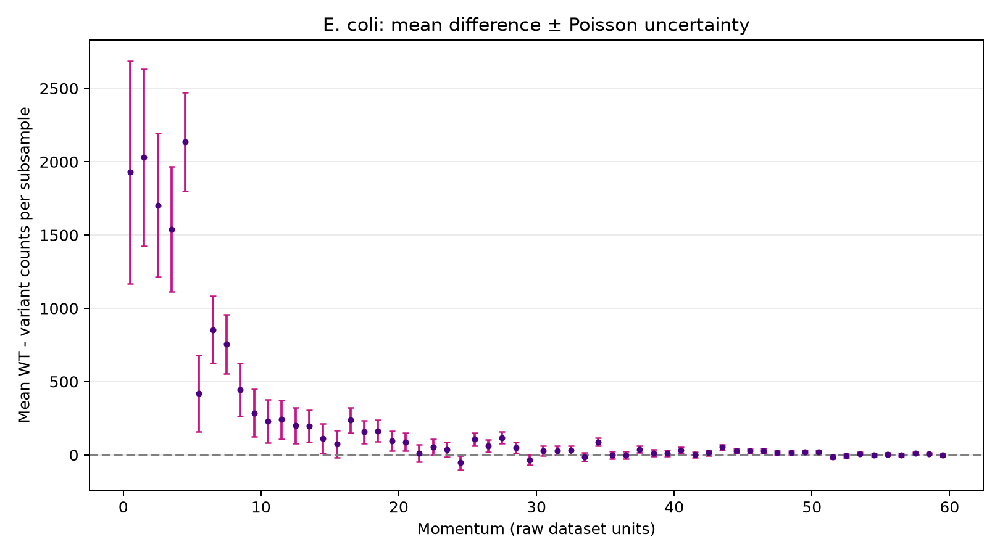
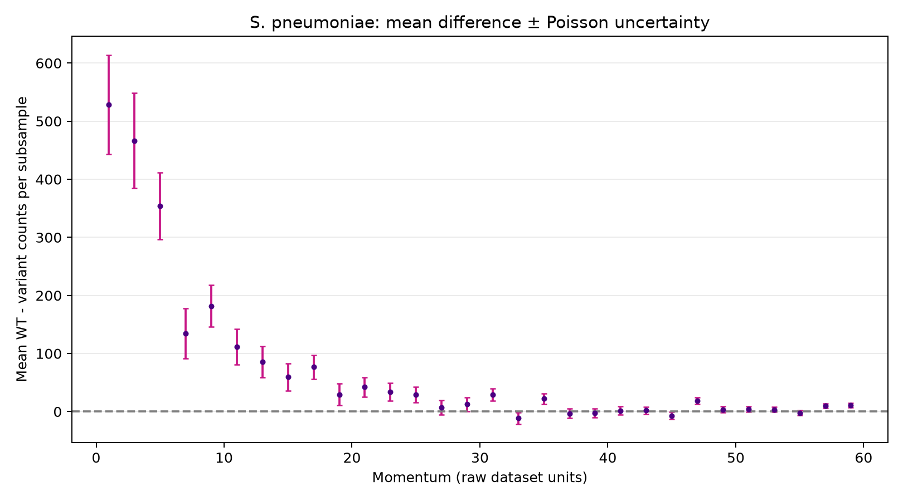

# Monitoring Bacterial Movement and Populations

**PRA2003 - Python Group 1**

This project analyses simulated bacterial tracking data to compare the abundance and momentum distributions of wild-type (WT) bacteria with their mutant or resistant variants. It uses ten subsamples to investigate whether differences are consistent across the data.

## Contents

- [Research questions](#research-questions)
- [Data and bacterial strains](#data-and-bacterial-strains)
- [Installation and running the analysis](#installation-and-running-the-analysis)
  - [Where are the figures and CSV results?](#where-are-the-figures-and-csv-results)
- [Analysis method](#analysis-method)
  - [Valid events and abundance](#1-valid-events-and-abundance)
  - [WT–variant abundance difference](#2-wtvariant-abundance-difference)
  - [Momentum and momentum-dependent difference](#3-momentum-and-momentum-dependent-difference)
  - [Uncertainty and the presentation feedback](#4-uncertainty-and-the-presentation-feedback)
- [Results](#results)
  - [Figures to examine first](#figures-to-examine-first)
- [Discussion](#discussion)
- [Libraries](#libraries)

## Research questions

1. What is the average abundance of each bacterial strain per valid event, and how much does it vary between subsamples?
2. What is the difference in abundance between each WT strain and its variant?
3. How does the WT–variant difference change with momentum?

## Data and bacterial strains

The input files are `output-Set1.txt` to `output-Set10.txt`. Each file contains event headers with the event number and number of particles, followed by particle rows containing `px py pz bacterial_id`. `output-Set0.txt` is excluded because it contains only one event.

| Species | WT ID | Variant ID | Variant description |
|---|---:|---:|---|
| *Escherichia coli* | 211 | -211 | Mutant |
| *Bacillus subtilis* | 321 | -321 | Mutant |
| *Pseudomonas aeruginosa* | 2212 | -2212 | Antibiotic-resistant |
| *Streptococcus pneumoniae* | 3122 | -3122 | Capsule-deficient |
| *Mycobacterium tuberculosis* | 3312 | -3312 | Drug-resistant |
| *Salmonella enterica* | 3334 | -3334 | Mutant |

The code analyses all six pairs. The final group presentation focuses on *E. coli* and *S. pneumoniae*.

## Installation and running the analysis

**Requirements:** Python 3.10 or newer and Matplotlib. The other imported libraries are part of Python's standard library.

Install Matplotlib in a terminal:

```bash
python -m pip install matplotlib
```

Arrange the files like this (the project folder can be anywhere on your computer):

```text
PRA2003/
├── PRA2003_Final_Code.py
└── data/
    ├── output-Set1.txt
    ├── output-Set2.txt
    ├── ...
    └── output-Set10.txt
```

**Input data:** The original simulation files (`output-Set1.txt` through `output-Set10.txt`) are not included in this repository due to their size. To reproduce the analysis, obtain these files from the PRA2003 course dataset and place them in the `data/` folder shown above. Alternatively, the files can be placed directly beside `PRA2003_Final_Code.py`.

The generated figures and CSV results are included in the repository, so they can be viewed without rerunning the analysis.

Open a terminal in the project folder and run:

```bash
python PRA2003_Final_Code.py
```

### Where are the figures and CSV results?

When the Python script is run locally, it automatically creates two folders beside the script: `figures/` for the 24 PNG graphs and `results/` for the nine CSV tables.

For the GitHub submission, the generated PNG and CSV files have been uploaded directly to the repository's main directory. The folder organisation on GitHub therefore differs slightly from the folders created by the script.

```text
PRA2003/
├── PRA2003_Final_Code.py
├── FINAL_README.md
├── asymmetry_211_-211.png
├── asymmetry_3122_-3122.png
├── momentum_211.png
├── momentum_-211.png
├── momentum_combined_211_-211.png
├── momentum_difference_211_-211.csv
├── abundance.csv
├── differences.csv
├── subsamples.csv
└── ... other PNG and CSV files
```

The 24 figures comprise 12 individual strain histograms, six combined WT-and-variant histograms and six momentum-dependent difference plots. The nine CSV files comprise three summary tables and six momentum-bin difference tables.

## Analysis method

### 1. Valid events and abundance

An event is **valid** when it contains at least one particle with one of the 12 selected IDs. Empty events and events containing only other IDs do not contribute to the valid-event denominator.

For strain $b$ in subsample $i$:

$$
a_{b,i}=\frac{N_{b,i}}{V_i}
$$

where $N_{b,i}$ is the number of particles of that strain and $V_i$ is the number of valid events in that subsample.

The pooled abundance reported in `abundance.csv` is

$$
a_{b,\mathrm{pooled}}=\frac{\sum_i N_{b,i}}{\sum_i V_i}.
$$

The CSV also reports the mean of the ten subsample abundances, their sample standard deviation (SD), and standard error of the mean (SEM). Pooled and unweighted subsample means may differ slightly if the subsamples have different numbers of valid events.

### 2. WT–variant abundance difference

For each pair, calculate the difference **within each subsample**:

$$
d_i=\frac{N_{\mathrm{WT},i}-N_{\mathrm{variant},i}}{V_i}.
$$

Then calculate the mean of the ten paired differences and their sample SD:

$$
\bar d=\frac{1}{n}\sum_{i=1}^{n}d_i,\qquad
s_d=\sqrt{\frac{\sum_{i=1}^{n}(d_i-\bar d)^2}{n-1}},\qquad
\mathrm{SEM}=\frac{s_d}{\sqrt n},\quad n=10.
$$

The **SD** describes the observed variation among subsamples; the **SEM** estimates the uncertainty of their mean. These are different quantities and should not be labelled interchangeably.

### 3. Momentum and momentum-dependent difference

The magnitude of each selected particle's momentum is calculated from its three components:

$$
p=\sqrt{p_x^2+p_y^2+p_z^2}.
$$

The plots cover momentum values from 0 up to (but not including) 60 in **raw dataset units**. The bin width is 1 for *E. coli* and 2 for the other species, including *S. pneumoniae*, consistent with the binning used in the presentation for those two focus species. The physical unit conversion has **not** been independently verified, so the graphs deliberately do not label the axis in SI units.

For each momentum bin $j$, the difference is first calculated for every subsample:

$$
D_{i,j}=N_{\mathrm{WT},i,j}-N_{\mathrm{variant},i,j}.
$$

The plotted point is the **mean raw-count difference** across ten subsamples:

$$
\overline D_j=\frac{1}{10}\sum_{i=1}^{10}D_{i,j}.
$$

This is a difference in **counts per subsample**, not a normalised ratio such as $(WT-variant)/(WT+variant)$, and not a difference divided by the number of valid events.

### 4. Uncertainty and the presentation feedback

The presentation calculated ten WT–variant count differences per momentum bin and displayed their **sample standard deviation (SD)** as error bars. That SD measures the variation observed between the ten subsamples; it was not a Poisson counting uncertainty.

The final code **keeps the same mean count difference**. The revised momentum plots instead show **Poisson counting uncertainty of the mean difference**. This correction follows the clarified assessor feedback: the histogram bins contain particle counts, so their error bars should use Poisson counting uncertainty rather than the sample SD of the ten subsample differences.

For *independent Poisson counts*, the variances add even though the counts are subtracted:

$$
\operatorname{Var}(N_{\mathrm{WT}}-N_{\mathrm{variant}})
=N_{\mathrm{WT}}+N_{\mathrm{variant}}.
$$

For ten subsamples, the Poisson uncertainty of the **mean difference** is

$$
\sigma_{\overline D_j}
=\frac{\sqrt{\sum_i N_{\mathrm{WT},i,j}+\sum_i N_{\mathrm{variant},i,j}}}{10}.
$$

Each momentum CSV contains the bin centre, mean WT–variant count difference and Poisson uncertainty used in the plot. The sample SD and SEM remain available for the **abundance** calculations in `abundance.csv` and `differences.csv`, but are not used as momentum error bars.

## Results

The completed analysis reported:

| Quantity | Result |
|---|---:|
| Subsamples analysed | 10 |
| Total events | 5,000,000 |
| Valid events | 4,614,632 |
| Selected bacterial particles | 221,204,606 |

Overall paired WT–variant abundance differences (mean ± **sample SD**, per valid event):

| Species | Mean difference | SD |
|---|---:|---:|
| *E. coli* | 0.03232033 | 0.00452232 |
| *B. subtilis* | 0.00569519 | 0.00329594 |
| *P. aeruginosa* | 0.02389043 | 0.00237470 |
| *S. pneumoniae* | 0.00490618 | 0.00058366 |
| *M. tuberculosis* | 0.00044100 | 0.00048830 |
| *S. enterica* | 0.00003554 | 0.00006859 |

These values indicate that the WT strain had a higher **average** count per valid event in each pair, although the size of the difference relative to variation differs by species. This observation alone does not establish statistical or biological significance.

### Figures to examine first

The following figures show the momentum-dependent WT–variant differences for the two bacterial species assigned to Python Group 1. Both figures were generated using Poisson counting uncertainty for the error bars.

The images are included directly in the GitHub repository and linked using relative file paths, allowing them to be displayed without downloading or rerunning the analysis.

**E. coli - WT versus mutant**



**S. pneumoniae - WT versus capsule-deficient variant**



Both use mean WT - variant counts with Poisson error bars. At low momentum the differences are generally larger; at higher momentum they tend towards zero. This describes the simulated data, not a demonstrated biological mechanism.

## Discussion

The results show that the WT strain has a higher average abundance per valid event than its corresponding variant in all six pairs. However, the differences are not equally large. For example, the mean WT–mutant difference for *E. coli* is approximately 0.0323 bacteria per valid event, compared with approximately 0.00491 for *S. pneumoniae*. These values should be interpreted in the context of each species' overall abundance rather than compared as absolute differences alone.

For the two species assigned to our group, Python Group 1, the momentum-dependent plots allow us to examine where the WT–variant count differences occur. The differences are generally larger in the lower momentum bins and become smaller towards the higher momentum bins. This suggests that the observed count imbalance is not uniform across the momentum range. However, the plots show differences in raw particle counts, so bins containing more particles may naturally have larger absolute differences.

The most important methodological correction concerns the error bars. In the presentation, we used the sample standard deviation of the ten subsample differences. That describes how much the observed differences vary between files, but it is not the counting uncertainty associated with the histogram bins. For the revised figures, I used Poisson uncertainty, where the variances of the independent WT and variant counts are added before taking the square root. Because each plotted point is the mean across ten subsamples, the uncertainty is divided by ten. This changes the interpretation of the error bars, but not the mean WT–variant differences themselves.


## Libraries

`matplotlib` for figures; `pathlib` for portable file paths; `csv` for output tables; `math` for momentum and Poisson calculations; `statistics` for means and sample SD; and `collections.defaultdict` for momentum-bin counts.
