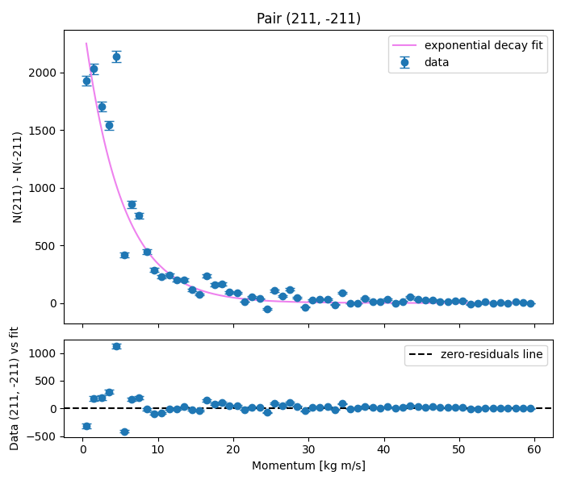
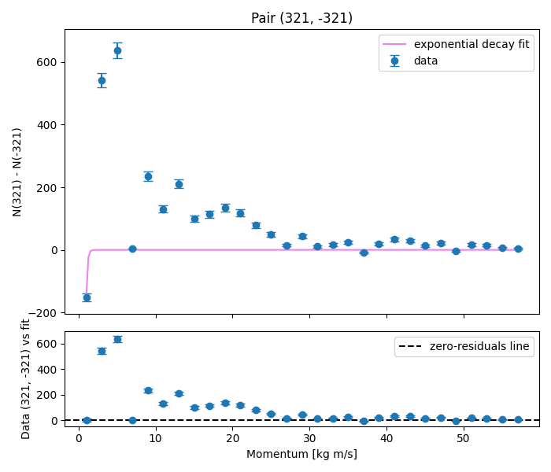
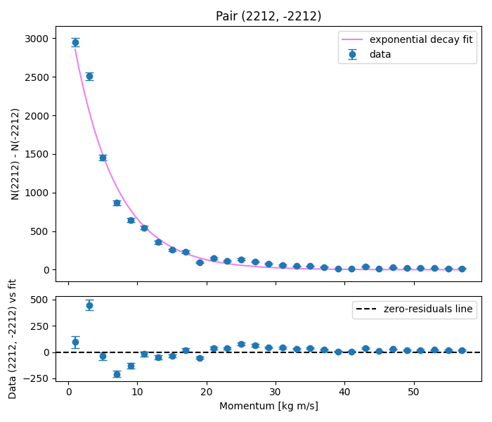
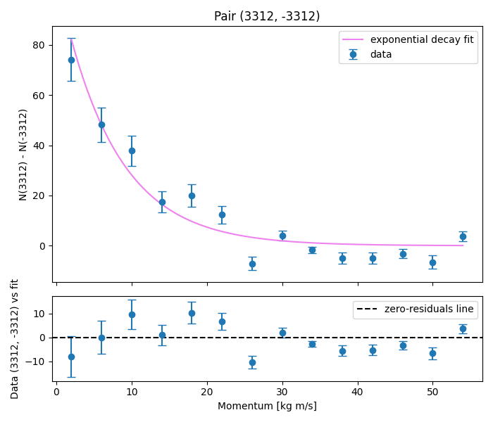
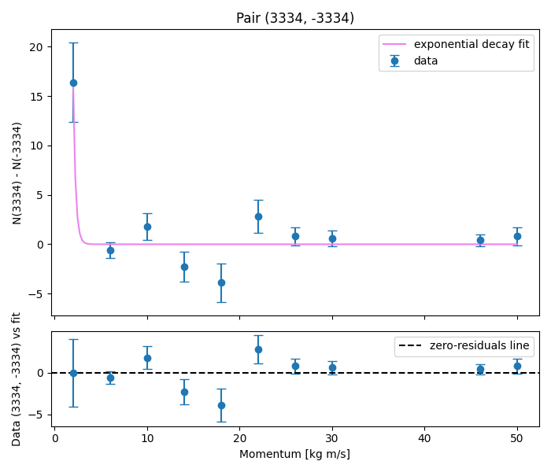

## Topic
🦠**Monitoring bacterial movement and populations**🐍

Each row of the input file contains all three momentum components of different bacterial strains with the corresponding ID code. Therefore the population of all bacteria types is represented by the number of rows. We can analyse the mobility and number of each species. The measurements were taken under different conditions such as: stress and nutrients. 

$$
p = \sqrt{{p_{x}}^2 + {p_{y}}^2 + {p_{z}}^2 }
$$

## Table of Contents

- [Installation](#installation)
  
- [File Structure](#file-structure)

- [Strains analyzed](#strains-analyzed)

- [Research outcomes](#research-outcomes)

- [Questions to address](#questions-to-address)

- [Libraries used](#libraries-used)

- [Code snippets](#code-snippets)

- [License](#license)

## Installation

Link to clone the repository: [repository](https://github.com/Aleksandra8880/python1.git)

Analyzed files were downloaded from: [link](https://surfdrive.surf.nl/index.php/s/7udCnWTk4yMUASD)


## File structure
```
📦 aleksandra
├─ LICENSE
├─ README-aleksandra.md
├─ deliverable2.py
├─deliverable3_final_truly.py
├─deliverable4.py
└─ deliverable7.py
```
©generated by [Project Tree Generator](https://woochanleee.github.io/project-tree-generator)


## Strains analyzed
- E.coli WT
- E.coli mutant
- Bacillus subtilis WT
- Bacillus subtilis mutant
- Pseudomonas aeruginosa WT
- Pseudomonas aeruginosa antibiotic-resistant
- Streptococcus pneumoniae
- Capsule-deficient streptococcus pneumoniae
- Mycobacterium tuberculosis
- Drug-resistant mycobacterium tuberculosis
- Salmonella enteric
- Salmonella mutant

## Research outcomes:
| Bacteria   | Average per event  | standard deviation   |
|------------|------------------- |--------------------- |
| 211        |19.96404222526273   |0.03277297367603035   |
|-211        |19.931721898491062  |0.031862995623137325  |
| 321        |2.5109760539147103  |0.004760470013110587  |
| -321       |2.505280866934113   |0.005510374977956562  |
| 2212       |1.2089141646344372  |0.0019158652790257896 |
| -2212      |1.1850237360153653  |0.002419119037614167  |
| 3122       |0.276800090574915   |0.0010762078233972018 |
| -3122      |0.2718939099983327  |0.0009852549484234705 |
| 3312       |0.039469937734426135|0.0002835326780196851 |
| -3312      |0.03902893521802833 |0.00040171753717196235|
| 3334       |0.001187962955206821|4.1700896418102735e-05|
| -3334      |0.001152423974429549|5.083297255816441e-05 |

The wild strains are more present within the population.

As a part of investigation the weighted average was also calculated, taking the event_count of each file as a weight. However, the difference between the averages was not significant. The analyzed sub-samples were all similar size, therefore this simplification is reasonable and supports the expected outcomes.

```python
weights {'output-Set1.txt': 461368, 'output-Set2.txt': 461516, 'output-Set3.txt': 461343, 'output-Set4.txt': 461322, 'output-Set5.txt': 461498, 'output-Set6.txt': 461668, 'output-Set7.txt': 461532, 'output-Set8.txt': 461543, 'output-Set9.txt': 461513, 'output-Set10.txt': 461329}
```

| Bacteria   | Asymmetry          | standard deviation   |
|------------|------------------- |--------------------- |
| 211,-211   |14914.6             |122.125               |
| 321, -321  |2628.1              |51.265                |
| 2212,-2212 |11024.6             |104.998               |
| 3122,-3122 |2264.0              |47.58                 |
| 3312,-3312 |203.5               |14.265                |
| 3334,-3334 |16.4                |4.049                 |

Global significant asymmetry above 3 sigma was observed for all 6 pairs.

---



*The fitting for E.coli(221, -211) was one of the best obtained. Its population was the most abundant within the samples, therefore 60 bins of width 1 were chosen to represent such big amounts of points realistically? . The exponential decay trend can be observed with the highest points above 2000 difference in counts per bin. The “guessvector” given to scipy was: [2800, 02] . Significant asymmetry can be observed on nearly the whole momentum spectrum. The most visible asymmetry is within the lower momentum range with the indicated decaying trend towards the higher momentum aptitudes. There are some points which do not match the trend, such as 5,6 kgm/s . The residual plot provides information how the curve fits the data and in this case it does so quite well.*



*The second pair Bacillus(321, -321) subtilis is the worst fitting. Here the exponential clearly does not match the data.*



*Pseudomonas aeruginosa (2212, -2212). The population was similar to Bacillus, therefore the same bin settings were used. The exponentially decaying curve matches the data well, and substantial residuals are only present in the lower momentum range(around 4 kgm/s and 7 kgm/s).*


*For Streptococcus pneumoniae(3122, -3122) different bin widths were implemented - width 4. The population is much smaller so collecting enough data within the bins was crucial to make the analysis feasible. Visually the exponential violet curve matches the datapoint. However, the residual plot signifies oscillation with positive and negative contributions. This is a big indicator that the performed fitting might not represent the data well.*



*Next investigated bacteria was Mycobacterium tuberculosis(3312, -3312). Bin width was again 4 and the data and fit resemble Streptococcus pneumoniae. The residuals suggest that the fitting is not truly accurate.*



*Discussing the last investigated bacteria strains pair, namely Salmonella (3334, -3334) the decaying exponential does not represent the data. The performed fitting was unsuccessful, which is greatly visible from the residuals analysis. For the future polynomial fitting could be a good alternative to account for the trend.*


## Questions to address: ##
- What are the average counts of each bacterial strain and their statistical uncertainties? 
- Is there any asymmetry between the normal and the mutant strain? 
- Is there any asymmetry as a function of their momentum? 

## Libraries Used
- python
- matplotlib
- Path
- statistics
- math
- scipy
 
## Code snippets
The asymmetry between the wild and mutant bacteria is checked by this part of the code:
```python
i_asymmetry = {i  : 0 for i in mutant_wild_pairs}
i_uncertainty = {i  : 0 for i in mutant_wild_pairs}

def mutant_vs_wild_asymmetry():
    count = {}    
    for i in mutant_wild_pairs:

        count[i[0]] = []
        for file in files:
        
            count[i[0]].append(len(momenta_file[file][i[0]]) )

        count[i[1]] = []
        for file in files:
        
            count[i[1]].append( len(momenta_file[file][i[1]]))
        
        asymmetry = ( np.asarray(count[i[0]]) - np.asarray(count[i[1]]))
        #mean difference from all 10 files
        mean_asym = np.mean(asymmetry)

        #now take a squareroot to obtain the standard deviation of the Poisson distribution
        if mean_asym >= 0:
            uncertainty_A = np.sqrt(mean_asym)

        i_asymmetry[i] = asymmetry
        i_uncertainty[i] = uncertainty_A

        up_bound = mean_asym - 3*uncertainty_A
        low_bound = mean_asym + 3*uncertainty_A

        if up_bound > 0:
            with open("result0.txt", "a") as outfile:
                outfile.write(f"There is a significant asymmetry in pair {i}. Wild type is more present within the samples.\n")
            print(f"There is a significant asymmetry in pair {i}. Wild type is more present within the samples.")
        if low_bound < 0:
            with open("result0.txt", "a") as outfile:
                outfile.write(f"There is a significant asymmetry in pair {i}. Wild type is more present within the samples.\n")
            print(f"There is a significant asymmetry in pair {i}. Mutant type is more present within the samples.")
        with open("result0.txt", "a") as outfile:
            outfile.write(f"Assymetry of pair {i} is {mean_asym} with the standard deviation {uncertainty_A}\n")
        print(f"Assymetry of pair {i} is {mean_asym} with the standard deviation {uncertainty_A}")
        
    
mutant_vs_wild_asymmetry()

```

## License
This project is licensed under the MIT License.
